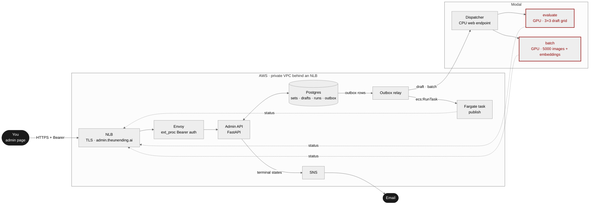
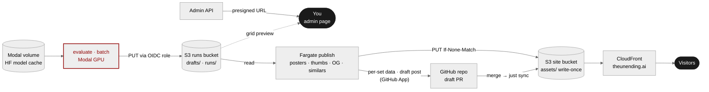

# The Unending: system architecture

How a prompt typed into the admin page becomes a published set on theunending.ai.
Two views of the same system: **who calls whom**, then **where the bytes go**.

## 1. Control: requests, jobs, callbacks

## 2. Data: generation, publishing, going live

## Notes

- **One way in.** People and jobs both reach the API through the NLB (TLS) and Envoy (Bearer check in
  ext_proc), so every status change passes the same auth. The EC2 box running Envoy, the API and
  Postgres sits in a private subnet; only the NLB is public.
- **The outbox is the only path to the outside world.** A commit or publish writes its outbox row in
  the same transaction as the state change; the relay launches the Modal job or Fargate task
  afterwards, so a duplicate request can't start a second batch.
- **No long-lived cloud keys in jobs.** Modal assumes an AWS role through OIDC; the Fargate task uses
  its task role; the admin box uses its instance profile. Private subnets reach S3 through a gateway
  endpoint and ECR through interface endpoints.
- **Published assets are write-once.** The publish role can only `PutObject` with `If-None-Match: *`
  under `assets/`, and has no delete permission anywhere.
- **Every publish only adds files.** The PR adds `_data/set_streams/<post>.json`,
  `_data/set_posters/<post>.json`, the stream manifest, the OG tile and a `_drafts/` post;
  `_plugins/set_data.rb` merges the per-set files at build time.
- **Backups.** A timer runs `pg_dump -Fc` and streams it to S3.
- **Planned:** a reconciler for runs that never report back (Modal call / ECS task status vs. S3
  contents), and a run-events log behind the status endpoint.
